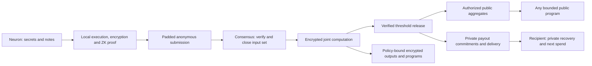

# privacy — a frozen anonymous machine

## 0. recommendation

Build the permanent machine from private programmable notes and a mandatory
collective computation layer. A neuron proves its own contribution locally,
then submits that contribution encrypted. The network computes over the sealed
contributions and reveals only the authorized aggregate and state effects.
Local zero-knowledge proofs certify inputs; they cannot supply this joint
computation by themselves.

Select post-quantum threshold homomorphic encryption as the collective
execution research baseline: an additive path for sums and bounded exact
encrypted evaluation for functions that need more. Distributed key generation,
controlled threshold release and publicly verifiable computation are part of
that same layer. Keep individual spending authority with the note owner.
Require anonymous submission and private recovery. Freeze the native monetary
law, collective release policy and verification rules together at genesis.

This is the architecture selected by this research. Its production freeze is
blocked. The present harness is a useful implementation substrate; its current
cryptographic and network profiles do not establish the requested guarantee.
The research question is whether this particular composition can meet the
security and device budgets, with explicit leakage, before permanent genesis.

The freeze unit is the complete implemented protocol: private inputs, joint
computation, consensus, disclosure, secret-state succession, transport, recovery
and every failure transition. All of it must work before the irreversible
monetary genesis. A primitive, a happy-path demonstration or a plan to complete
any of these functions after launch cannot satisfy the freeze. The present
proposal is a research specification; it is not a complete qualified protocol.

This page proposes a decision. `draft` follows the proposals registry: owner
acceptance and implementation remain outstanding. Existing accepted specs,
release pins, monetary parameters and launch decisions are unchanged by this
research. Inspection evidence, exact revisions and executable counterexamples
are in [the research receipt](../audit/privacy-2026-10-16/README.md).



## 1. the promise to freeze

The primary interpretation is already explicit in [[cyber/launch]]: P1 makes
the [[cyberlink]] public and its author private. Everyone can learn the
assertions; the protocol conceals their assignment to private [[neurons]].
P2 conceals holdings and transfers. P3 conceals a settlement miner's private
witness beyond the authorized public result.

The guarantee is a simulation/indistinguishability claim: given the declared
public output and the adversary's own inputs, the observable execution should
reveal no additional protected information. Two honest authors exchanging
assignments to otherwise identical public assertions should be indistinguishable
under the declared network and corruption assumptions. Cryptographic hiding
and traffic-analysis resistance require separate arguments and compose at the
actual wire boundary.

| surface | public by construction | protected |
|---|---|---|
| monetary transition | accepted root, nullifiers, new commitments, fee class, padded envelope, proof | input-note association, ownership, amounts, asset/policy data unless explicitly disclosed |
| public assertion | particle pair and the application-approved public payload | author, individual contribution weight and its private authority/holdings |
| public [[focus]] computation | the authorized aggregate graph and result | individual summands and identities, subject to aggregate-output leakage |
| private program | declared public IO and resource class | witness, private state and accesses inside that class |
| settlement | accepted input-domain commitment, epoch, authorized aggregates, payout commitments | protected contributor assignment, marginal vector and private ego-net |
| transport | declared schedule, packet class and service availability | assignment of originating connections to published assertions |

For the requested machine, individual weights and protected reports stay
hidden; the authorized aggregate becomes public. This makes §6 mandatory at
genesis. A public particle pair discloses the target of an anonymous assertion,
but does not authorize disclosure of its weight or author. Public per-neuron
balance/focus/karma deltas conflict with concealing those same transitions.
Private reputation travels as an authenticated private state credential with
controlled disclosure.

Authorized recipients and authors know their own interactions. A message can
identify its author by its content; unique values, timing and outside facts can
also identify it. The privacy game conditions on those intentional disclosures.
An unconditional promise that nobody can ever infer an author is unattainable.

## 2. what the workspace actually establishes

The research distinguishes default-branch code, release-branch code, local
research, measured fixtures and projections. Their exact snapshots are recorded
in [sources.json](../audit/privacy-2026-10-16/sources.json).

| claim | evidence and disposition |
|---|---|
| the current launch is already the permanent private core | refuted: [chain](../specs/chain.md) specifies public transfers/cyberlinks, NSIG1/secp256k1, and activation of privacy by later scheduled fork |
| private proving has made no progress | refuted: zheng's `origin/release/0.4` has masked proofs and a soundness ledger; the [latency receipt](../audit/proof-latency-2026-10.md), including its final fast-path follow-up, records substantial progress |
| those fixtures qualify private money and settlement | open: a hidden membership fixture is a component, while P2/P3 require complete accepted statements, recovery, network privacy and adversarial integration |
| the implementation called `veil` inherits the VEIL paper's guarantees | refuted as an identification: its own ledger describes a Libra-style masked sumcheck plus hiding PCS and explicitly distinguishes it from the VEIL paper |
| a classical ROM bound establishes the requested quantum guarantee | open: the current proof ledger prices grinding in the classical ROM; the deployed composition needs its own quantum analysis |
| current Hemera is ready for an irreversible security freeze | open: local research withdraws the degree argument for inverse partial rounds; the default branch still carries conflicting claims; output width also constrains the generic collision bound |
| a jali ciphertext norm verifies exact monetary conservation | refuted for the formula in `bbg/specs/privacy.md`; the receipt constructs a nonzero imbalance that passes its proposed check |
| resetting the live nullifier table preserves lifetime uniqueness | open unless an accepting proof authenticates all relevant spent history; an accumulator name and archived roots alone supply no such check |
| public aggregates always conceal individual contributions | refuted: subtraction, a singleton batch and colluding contributors reveal exact values |

The [[privacy trilateral]] identifies three jobs that this collective machine
actually needs: prove eligible inputs, compute jointly without exposing them,
and distribute authority over disclosure. Owner-only private execution solves
the first job. Threshold encrypted evaluation and distributed protocols solve
the other jobs under their declared assumptions. A sum needs only additive
homomorphism; arbitrary bounded joint functions need a more expressive secure
computation protocol. Shared Goldilocks arithmetic alone establishes neither
an FHE scheme nor its security, error bounds or efficiency.

## 3. the monetary kernel

### 3.1 one private note model

Use one mandatory shielded note pool for the native currency. Voluntary
disclosure is an application proof/view of a note; it does not create a cheap
public transfer lane that empties the shared privacy pool.

The following is a relation sketch, with canonical tagged encodings throughout:

```text
note = (asset, bounded_integer_value, authority, policy, private_state, rho)
cm   = H_security("note", chain, encode(note))
nf   = PRF_nk("spent", chain, rho, cm)

state = (note_commitment_root, persistent_nullifier_root,
         public_graph_root, collective_input_root, collective_key_context,
         supply_state, protocol_context)
```

`rho` is fresh high-entropy note randomness. `nk` is derived from, and bound to,
the note's authorized private nullifier credential. Every valid spend of one
note produces the same nullifier, including threshold or delegated spends.
Changing the recipient policy consumes the old note and creates a new one.
The spender cannot choose an alternative `nk` or an epoch-dependent nullifier
to spend the old note again. Nullifiers are full security values, never one
Goldilocks element obtained by reduction.

Start with a conventional append-only hash tree of note commitments and an
exact persistent nullifier set. A public authenticated tree can contain hiding
commitments: its membership opening is checked inside ZK. A polynomial backend
can optimize that implementation only after its exact hiding, membership,
non-membership and update relations are qualified. Neptune's
[mutator-set work](https://eprint.iacr.org/2023/1208) is a useful alternative to
measure, with its witness-update and archival obligations included.

Pruning is allowed when authenticated evidence still permits every old valid
note to be spent and every old spent note to be rejected. Epoch boundaries
preserve this invariant. Tree capacity, historical-root acceptance, witness
updates and archive availability have to be specified before freeze.

### 3.2 the exact proof

The public statement binds the network/genesis, fixed proof profile, accepted
root, transaction intent, nullifiers, output commitments, delivery-data binding,
public effects, fee, validity window and padded resource class. The accepting
verifier derives the expected relation; a prover-supplied program digest cannot
replace the verifier's policy.

The private witness supplies input notes, membership paths, ownership material,
output preimages and application execution. The relation checks:

1. Every input belongs to an authenticated eligible root; all note encodings and
   values are canonical. Duplicate inputs/nullifiers within a transaction fail.
2. Its committed authority authorizes this exact intent. Recipient encryption
   keys and spending authority are independent: a sender knowing the delivery
   secret does not gain the recipient's spending credential.
3. Every nullifier is correctly derived from the consumed note. Consensus checks
   absence against current spent state and uniqueness across the admitted batch.
4. Per-asset integer conservation holds, with explicit mint/burn authority and
   native issuance restricted by the frozen law. Limb/range checks prevent field
   wraparound; equality modulo the Goldilocks prime is insufficient.
5. Each input policy accepts the transition and all successor state/policy
   obligations hold. The native currency's conservation/issuance predicate is
   enforced outside application discretion.
6. Each encrypted collective contribution is bound to the same eligible private
   state, declared computation, epoch key and output policy. The proof checks
   encryption/plaintext consistency, bounded encoding and correct local
   preprocessing. A proof of a valid commitment alone cannot authenticate an
   unrelated ciphertext. Publishing the aggregate uses the separate relation
   in §6; input admission never substitutes a plaintext individual weight.
7. Encrypted delivery data and output commitments refer to the same transition.
   The recovery profile defines which delivery-consistency checks are proved,
   so an admitted payment has its promised recoverable data.

Validators apply those verified effects atomically to their own canonical
state. A historical-root membership proof does not establish present unspentness.
An outer aggregate verifies complete client proofs and their public effects;
the aggregator receives no spend secrets. Recursive compression is an
optimization with separate qualification. Direct verification remains the
reference semantics and sets an explicit finite block budget.

## 4. programmability and immutability fit together

A note carries a policy/program commitment and state. A bounded [[nox]] program
checks a spend and constructs successor outputs. [[trident]] supplies the
language; the frozen interpreter/relation supplies the meaning. Programs can
implement timelocks, escrow, swaps, delegated rights and application-specific
state transitions.

The execution boundary follows who can know the inputs:

| computation | chosen execution |
|---|---|
| custom program over published outputs | anyone executes it and can prove the result |
| custom program over a neuron's own hidden notes | that neuron executes/proves locally; verifiers learn the permitted result |
| native aggregate over hidden contributions | mandatory encrypted aggregation and authorized threshold release, §6 |
| custom program over sealed outputs belonging to several independent neurons | bounded threshold encrypted evaluation under the outputs' policies; no single evaluator receives the plaintext witnesses |

An opaque commitment supplies binding. Computing on its hidden preimage needs
an additional protocol. In the selected research architecture anyone can
evaluate an admitted bounded circuit over compatible ciphertexts and prove its
execution; obtaining a plaintext result additionally requires the release
policy and threshold protocol. A program returning one protected input is not
automatically authorized just because its evaluation is correct. Native
aggregate/reward functions have fixed release policies; application outputs
carry explicit policies from creation.

Owner-only spends can use local ZK without homomorphic evaluation. That
optimization does not remove encrypted joint computation from the requested
machine. Pure sums use the additive path. Bounded nonlinear circuits use exact
leveled HE where its depth suffices; persistent composition beyond that depth
requires a qualified refresh/bootstrapping protocol in the frozen profile.
The research must establish these bounds before promising encrypted contracts.
MPC is a valid alternative execution technique, but a sum-only primitive cannot
implement general hidden-input contracts by itself.

Freeze the interpretation, encodings, native monetary law, admission relation,
proof verifier/parameters, accepted crypto profiles, resource bounds, conflict
rules and finality rules. New application programs remain ordinary data under
that fixed interpretation. They cannot replace the native verifier, expand
native mint authority or reinterpret old outputs. A new proof algorithm can be
implemented inside the old machine; its final acceptance still rests on the
old trust anchor. This supplies no rescue if that anchor breaks.

An immutable specification permits faster conforming implementations and
repairs of implementations that fail to implement it. It supplies no authority
to change the accepted state-transition relation. Universality does not make
the crypto foundation upgradeable, and governance cannot promise to prevent
people from creating a different fork.

The gold analogy is a commitment to fixed verification and issuance rules.
Scarcity/fungibility and economic value are separate properties. Cryptographic
security remains conditional on assumptions and a quantified adversary; no
finite deployed scheme establishes security for an unlimited future.

## 5. public collective knowledge and consensus

P1 publishes `(p, q, permitted_public_payload)` with a proof of anonymous
eligibility/resource expenditure. It omits the permanent neuron identifier,
identity signature, per-neuron nonce and private ownership opening. The fee
and stake resource come from shielded notes. Anonymous membership alone gives
no scarcity: Sybil resistance comes from the specified scarce resource and
replay/exclusivity rules.

Consensus validates and orders the encrypted contributions, then closes their
canonical input set. The collective protocol computes and releases the allowed
aggregate graph. Only after that release can the basic [[focus]] calculation
run on public data. The threshold key protects contributions until authorized
release; no individual party is given the complete decryption key.

If consensus itself requires private weighted votes, freeze a separate
credential relation: lock eligible stake through the voting/slashing interval;
authenticate its snapshot and weight; derive an exclusivity tag for the whole
conflict domain/round; bind the selected proposal in the proof. Putting the
proposal identifier in that exclusivity tag would allow one stake credential
to vote for every competitor. Vote switching, withdrawal and reorgs must have
one exact rule. Credential splitting cannot create additional weight.

This changes the author-based conflict check in `foculus/specs/protocol.md`.
The safety/liveness argument must be redone against the new observable data.
ZK proves validity; it supplies neither agreement nor availability. A public
validator role can coexist with anonymous assertions, but that role's actions
then have an explicitly public identity. Fully anonymous validators are a
further consensus requirement, not an implication of P1.

P3 requires a result proof over the complete admitted input scope and private
payouts. A miner may prove a standalone marginal using its own witness. The
epoch settlement also needs other neurons' protected reports and grouped
contributions. Giving those witnesses to one miner would cross the privacy
boundary even if the final proof hid them from everyone else. The collective
protocol below is therefore required for this reward machine.

## 6. mandatory collective computation

### 6.1 decompose the actual aggregate

[[tru/specs/attention]] defines the effective adjacency as

```text
x_l(p,q)    = a(l) * kappa(nu(l)) * f(m(l))
A_eff[p,q] = sum_l x_l(p,q)
phi        = tri_kernel(A_eff)
```

The efficient cut is local preprocessing, encrypted aggregation, authorized
release, then public computation. When a neuron possesses authenticated
witnesses for all factors at the accepted snapshot, it computes its `x_l`
locally. It proves the factors, resource constraints and prescribed arithmetic,
and encrypts that same `x_l`. The network sums the ciphertexts. It releases
`A_eff` under the fixed disclosure policy, then anyone computes `phi` and
custom programs over this public aggregate. If a factor is itself a joint
secret, its calculation stays inside the collective protocol.

This factorization is a proposed execution strategy, not a measured speedup.
It preserves the distinction between a local nonlinear product and a nonlinear
function of several independent secrets. Generic local ZK supplies no sum of
unknown witnesses. The formulas and their exact source provenance are recorded
in [the receipt](../audit/privacy-2026-10-16/README.md).

### 6.2 the encrypted sum and its acceptance relation

Use a common threshold public key for the admitted epoch/computation domain:

```text
c_l = Enc(pk_epoch, x_l; r_l)
pi_l = ZK(eligible state, valid x_l, c_l encrypts that x_l,
          domain, epoch, nullifier, output policy)

B = finalized ordered set of accepted (c_l, pi_l, public routing data)
C = AddHE(c_l for l in B)
A = ThresholdRelease(C, root(B), program, policy)
```

`AddHE` denotes the selected scheme's ciphertext operation, not plaintext
field addition. Independently addressed recipient ciphertexts are not already
compatible aggregate inputs. The complete protocol must establish:

- eligibility and encryption consistency for every input, exactly-once
  inclusion of the canonical set, and binding to its accepted state snapshot;
- canonical bounded integer/fixed-point encoding, prescribed rounding, maximum
  batch size, no plaintext-modulus wraparound, and a decryption-failure budget;
- recomputable or proved evaluation over exactly `root(B)`, and verifiable
  threshold decryption bound to the approved result ciphertext and function;
- disclosure of only the designated output slots, including sanitization of
  unused packed slots and the distributed decryption transcript;
- deterministic admission, exclusions, timeout, reorg and restart rules that
  cannot turn retries into releases over attacker-chosen overlapping subsets.

Publishing a correct decryption proof does not authorize that decryption.
Honest key-share holders release only the finalized, policy-approved result.
Accepting arbitrary result ciphertexts would create a decryption oracle for
individual inputs. Threshold collusion remains a confidentiality assumption;
public verification cannot stop enough colluding holders decrypting privately.

For public `(p,q)`, routing to an aggregate bucket is public. Concealing the
target as well requires padded vectors or an oblivious routing/histogram
protocol; sparse ciphertext addresses otherwise reveal support. Even with
public targets, singleton and incremental aggregates can reveal a weight.
The release policy must resolve that leakage before claiming hidden weights.

### 6.3 what summation cannot settle

| function | required private work | allowed release |
|---|---|---|
| effective adjacency with locally available factors | local product proof, then encrypted sum | policy-approved aggregate adjacency |
| focus on that released adjacency | ordinary public tri-kernel computation | focus and custom public computations |
| valence/report totals | encrypted sums over the specified eligible domain | only approved totals/statistics |
| BTS surprise | construct crowd references, then evaluate each protected report against them | the specified aggregate and private score/state updates |
| contributor-grouped Shapley settlement | coalition-dependent evaluation using authenticated contributor grouping and the fixed sampling rule | authorized total, proof and encrypted payout/state updates |

The inspected [[tru/specs/rewards]] working draft makes the obstacle explicit:
surprise depends on the crowd collected at epoch close, and Shapley depends on
`v(S + nu) - v(S)` for different contributor coalitions. The aggregate graph
alone does not in general preserve the required contributor decomposition.
Nor does summing standalone marginal proofs compute the joint settlement.
An optimized BTS protocol might release sufficient crowd statistics and then
use local proofs; that optimization is admissible only if those statistics and
their repeated releases fit the leakage policy. This proposal makes no such
unproven sufficiency claim for the full settlement function.

Select exact threshold HE evaluation for the bounded joint circuit as the
research baseline, with additive-only evaluation where the algebra allows it.
Evaluate a malicious-secure MPC implementation of the same function as the
comparison for cost and availability. These are ways to realize one fixed
functionality; the production protocol must be chosen and reviewed before
freeze. An approximate numeric evaluator cannot silently change monetary
conservation or reward rounding. Programmable evaluation needs bounded control
flow, private indexing where required, and an explicit depth/refresh budget.

[Multiparty BFV research](https://eprint.iacr.org/2020/304) supplies a concrete
RLWE-based starting point for public ciphertext evaluation with distributed
keys. Its stated semi-honest model does not qualify this malicious environment.
[OpenFHE's security notes](https://openfhe-development.readthedocs.io/en/latest/sphinx_rsts/intro/security.html)
also distinguish library guarantees from active protocol security and warn
about extra packed-slot disclosures. Existing
[secure aggregation](https://eprint.iacr.org/2017/281) supplies a separate sum
reference. None certifies our PQ parameter set, release policy or reward circuit.
The native Goldilocks `mudra::veil` proposal remains unqualified; arithmetic
alignment alone cannot justify freezing a new cryptosystem.

### 6.4 the network holds the secret through evolving hidden roles

Select evolving-committee proactive secret sharing (ECPSS), extended through
YOSO-style verifiable state propagation, as the secret-custody research
architecture. [Can a Public Blockchain Keep a Secret?](https://eprint.iacr.org/2020/464)
constructs sharing and resharing to hidden successor committees, addressing the
targeted-corruption problem of small public committees. Its secrecy relies on
bounded mobile corruption, erasure and a specified communication model. The
[lineage review](../audit/privacy-2026-10-16/network-secret-lineage.md) separates
that result from later constructions and from this proposal's design decisions.

Apply the following requirements to every secret-bearing role:

1. Assign the role without exposing its physical holder before its work is
   finished. Selection is weighted by the frozen scarce-resource rule; naming
   anonymous addresses alone supplies no corruption bound.
2. Deliver shares to the hidden role through a PQ receiver-anonymous channel
   with the required selective-opening/adaptive security. Binding a public key
   to an undisclosed holder needs an actual construction.
3. Verify input shares and compute the bounded operation, successor sharings,
   proof and any authorized partial result. The full service secret is never
   reconstructed at one machine.
4. Prepare the complete outgoing message; erase shares, masks, decryption keys
   and other state that would recover them; only then publish. Retransmission
   may replay that same prepared public message. A second secret-dependent
   message requires a fresh role and a proved protocol transition.
5. Successor roles privately recover fresh shares from publicly verifiable
   encrypted handoff data. A live secret continues across changing holders;
   old shares are not accumulated as if they belonged to one sharing.

This is an implementation requirement derived from the selected architecture,
not a claim that a generic threshold library already implements YOSO.
Interactive DKG, refresh and threshold decryption must themselves fit the role
schedule. A holder cannot reveal its identity during decryption and then retain
the same share to serve later requests. Nor may private recovery restore an
erased protocol share from an old device backup. Ordinary note recovery and
ephemeral service-role state have different retention rules.

Distinguish share refresh from key rotation. Refresh changes the shares of the
same secret; it preserves the ability to decrypt ciphertexts under that key.
Fresh domain/epoch keys limit the exposure of completed computations only after
every decrypting path has been retired. Persistent encrypted application state
needs a qualified state/key transition. The frozen protocol includes these
repeating transitions from genesis. Executing them is ordinary operation of
the fixed protocol, with no algorithm upgrade or new authority.

Bound corruptions over the entire refresh/handoff window, including retained
access to decryption keys, and state how compromised machines recover. Erasure
is an assumption about honest execution; a public proof cannot prove that a
machine forgot a copy. No key backup may silently defeat it. Confidentiality
and availability thresholds, offline roles, targeted denial of service,
selection bias and repeated-committee lifetime failure all need joint bounds.
The network must preserve and use the secret under those bounds. A live
decryption threshold controlled by the adversary still violates confidentiality.

The original ECPSS theorem uses synchronized authenticated broadcast.
[[foculus/specs/protocol]] describes partial synchrony and domain-local finality.
Those models do not compose by naming an epoch. A stopped consensus clock can
leave a secret exposed to continuing real-time compromise. Before freeze,
the concrete protocol must close that partition/refresh model and guaranteed
completion after permitted outages; a timeout and permanent halt alone do not
meet the fully working protocol requirement.

### 6.5 close the computation/consensus dependency

Use the last finalized public snapshot to authenticate the next computation's
eligibility, input closure, role-selection context and release authorization.
The current secret result cannot be a prerequisite for finalizing its own
release request. Proposed dependency:

```text
finalized state S_e
  -> eligible encrypted input set B_e and fixed function/policy
  -> canonical certificate for B_e under the existing finalized context
  -> verifiable private computation + policy-bound threshold result
  -> atomic aggregate/payout/state transition to S_(e+1)
```

This is a required pre-genesis consensus design change wherever the current
rules create that circular dependency. Handoff continuity must also function
when application input is empty or application settlement is delayed.
Certificate domains include chain, finalized root, role generation, input root,
program and release policy. Forks cannot reuse a one-time role or decrypt
conflicting subsets. Initialization must generate the first distributed secret
and establish eligibility/randomness without a hidden trusted dealer or a
beacon that already requires the missing secret.

The complete protocol must instantiate this dependency with foculus agreement,
data availability and conflict rules. No existing foculus theorem is being
claimed for the changed relation. Encryption validity, committee secrecy,
public verification and consensus finality require one end-to-end argument.

### 6.6 release leakage and the genesis decision

Output leakage remains even with perfect MPC. If `S = sum(x_i)`, an adversary
knowing every term except one recovers that last term. Publishing two exact
sums over sets differing by one contributor has the same effect. Arbitrary
public programs returning `x_i` cannot coexist with concealment of `x_i`.
Fix the release function and cadence, analyze adaptive overlapping releases
and sparse contributions, and state the residual leakage. Batch size alone
does not count independent honest participants. Differential privacy belongs
to suitable analytics; monetary conservation and deterministic finality retain
exact arithmetic.

Decision: this collective layer is a genesis prerequisite. Owner-only ZK plus
public individual outputs fails the requested machine. A sum-only encrypted
layer also fails the general private settlement/contract requirement. Qualify
the complete bounded function and its release policy before permanent genesis.

## 7. transport, delivery and recovery

### anonymous ingress

Use a dedicated mix layer with fixed packet classes, independent delay/batching,
cover traffic, replay defenses and an authenticated relay directory. Charge its
resource use through unlinkable authorization, and include its cost in fees.
The adversary model includes observation of ingress and public publication,
malicious relays, active dropping/tagging, intersection attacks, retries and
low-traffic periods. Honest relay assumptions must specify path selection,
corruption timing, erasure and how anonymity survives an active adversary.

[[radio]] supplies transport, not this end-to-end anonymity guarantee. QUIC
encryption, a fresh transport key, or a single forwarding relay is insufficient.
Packets containing one large proof must be padded and scheduled as a bundle;
packet-count patterns can identify a transaction even when individual packets
are fixed-size. Cover traffic must reach the observable layer being protected.

The [anonymity trilemma](https://eprint.iacr.org/2017/954) makes this a real
latency/bandwidth tradeoff under its global-observer model.
[Loopix](https://www.usenix.org/conference/usenixsecurity17/technical-sessions/presentation/piotrowska)
is an architectural reference for traffic shaping; its original cryptography
is not a ready PQ packet profile. PQ packet composition and active security
are freeze gates. A direct, identity-bearing fallback must surface an explicit
weaker guarantee rather than silently satisfy a private submission request.

### recipient delivery

Select standard ML-KEM-1024 plus a reviewed KEM–KDF–AEAD composition as the
qualification baseline for `mudra::seal`. Preserve the
[FIPS 203](https://csrc.nist.gov/pubs/fips/203/final) algorithms and parameters;
rewriting its ring into Goldilocks creates a new cryptosystem. CSIDH and a
custom native-field KEM remain outside the permanent baseline.

Recipient-key privacy and ciphertext robustness need separate review. An
IND-CCA KEM certificate is not a recipient-anonymity certificate; the
[anonymous PQ encryption literature](https://eprint.iacr.org/2021/708) explains
the distinction. This paper predates final ML-KEM and is not evidence of an
attack on today's standard. Until the exact delivery envelope's anonymity
argument closes, private recipient delivery remains blocked. Key directories,
view tags, address reuse and access logs belong in that argument.

Freeze a padded, durable encrypted notification board with each ciphertext
bound to its output. Separate spend, view/discovery and transport keys.
The sender must never learn the recipient's spend secret. A compromised view
key exposes its advertised history; a long-lived recovery key is incompatible
with claiming erased historical access under that same key.

### recovery is part of ownership

Follow [[mudra/private recovery]] and [[cybergraph/private retrieval]]: a spell
reconstructs keys, while archives preserve notes and membership/spent evidence.
Use a complete local scan as the reference recovery algorithm, with fixed
traffic behavior where required. Private indexed retrieval and prepared
encrypted checkpoints are optimizations with completeness proofs.

Measure discovery, restoration and spend preparation separately. Private
membership paths fetched by ordinary address-specific RPC disclose which
note is being spent. Use local data or a qualified private retrieval profile.
Lost archives, provider refusal, overflow, cold restore, key epochs and reorgs
must have executable recovery behavior. A succinct proof cannot reconstruct
missing ciphertexts.

## 8. the quantum and lifetime freeze

Set a minimum target of 128-bit post-quantum work resistance for the monetary
security profile, with a separately budgeted lifetime soundness/hiding error.
This is a proposed requirement consistent with [[proof-system-repair]], not a
claim about present code. Fix the attack model and exposure budget first.

The concrete conservative reference is SHA3-512 for security commitments,
program/policy binding and authenticated state, and standardized SHAKE256-based
derivation with explicit domains where required. [FIPS 202](https://csrc.nist.gov/pubs/fips/202/final)
defines those primitives. The proof's own binding/transcript construction must
meet the same target, including internal Merkle nodes; an outer strong hash
cannot repair a weak inner proof or an already-collided state root.

Keep the existing 32-byte Hemera [[particle]] as a file locator only where its
security model permits. Add a distinct, full-width security commitment for
consensus-critical payloads/programs; validators authenticate the actual bytes
against it. A 32-byte particle alone cannot name executable policy authoritatively
under a stronger collision target. This is an explicit pre-genesis type/schema
change. If every security binding must remain the present Hemera value, the
stronger freeze requirement fails.

For an ideal n-bit output, the generic quantum collision algorithm has roughly
`2^(n/3)` query cost; this is a model bound with substantial resource assumptions,
not an announcement of a practical attack. A 256-bit output consequently
cannot support a blanket 128-bit quantum collision claim. Wider output alone
does not strengthen an internally narrower construction: expanding BLAKE3's
output or hashing a short digest again does not repair its binding. See
[Brassard–Høyer–Tapp](https://arxiv.org/abs/quant-ph/9705002).

The field-native proof hash is an optimization research question, with the
conservative construction as the comparison. Reusing an independently reviewed
exact parameter set is preferable to inventing an inverse-S-box security
argument. Any promoted replacement has to close its own complete security
ledger and measured advantage before the single production profile is frozen.
This page does not certify SHA3-based proving as fast enough on this harness.

The proof audit must cover the exact relation, hiding of every transcript
message, fresh entropy, Fiat–Shamir in the quantum random-oracle model,
grinding, multi-target/lifetime losses, nested verification and side channels.
Goldilocks execution can remain, with an adequately sized extension challenge
field and canonical sampling. A base-field bit count and a hash bit count are
not interchangeable.

The current release ledger's masking-error upper bound is also material:
it has a term proportional to `types * log(m) / p`, despite extension-field
challenges. That upper bound does not demonstrate an attack, but it does not
establish the requested lifetime hiding budget either. Improve the construction
or tighten the argument; a distribution test is no replacement for either.

Freeze forbids an automatic public-proof fallback, indefinite secp256k1 native
authorization, a privileged mint/recovery master key and verifier replacement
by an activation vote. Legacy ownership must be re-authorized into the final
PQ profile under an explicit pre-genesis distribution process. Unclaimed legacy
balances force a real decision: retaining a classical claim path retains its
classical security. No proof wrapper makes an exposed legacy key quantum-safe.

## 9. efficiency on the actual harness

Optimize after fixing the relation and leakage: specialized digest-pair gadgets,
shared membership paths, reusable proving keys, fixed common transaction shapes,
batch verification and off-device aggregation of already private proofs. Keep
raw witnesses on the originating device or explicitly inside its trust boundary.
Held proving keys may be reused; hiding coins may not.

Use the current [[zheng]]/[[lens]] release work as a baseline, including the
final follow-up of the [latency report](../audit/proof-latency-2026-10.md).
Its private node-membership optimization is real recorded progress. It still
does not meet all proof-size goals and does not measure this complete payment,
delivery or consensus relation. Historical timings cannot be transferred to a
different hash, tree, statement or quantum parameter set.

The experiment compares complete P1, P2 and P3 fixtures at identical security:
CPU, Metal and available mobile hardware; cold/warm prover latency and peak
memory; first/repeated verification; proof, ciphertext and cover-traffic bytes;
witness maintenance; full/warm recovery; archive growth; and adversarial rejection
cost. Report medians and tails with committed revisions, hardware, parameters
and commands. Device budgets include delivery construction and private reads.

The collective fixture must include input-encryption proofs, the real adjacency
sum, BTS and contributor-grouped settlement, evaluation/proof costs, key
generation and refresh, all committee traffic, threshold release, private
payout construction, and withholding/reorg recovery. Compare the additive
path, bounded exact threshold HE and malicious-secure MPC at the same leakage
and corruption model. Include packed-slot cleanup and private routing where
claimed. A fast ciphertext sum or a fast local proof alone cannot establish
end-to-end efficiency of this machine.

Carry the existing warm device proving target of at most one second; the
small/large proof and verification targets of [[proof-system-repair]] stay
targets. Add explicit total transaction and network-delay budgets before the
experiment. Security parameters cannot be reduced to make a latency row green.
If the required security and efficiency fail together, the final genesis waits.

## 10. research programme and closing conditions

Existing primitives express private notes, encrypted sums and bounded joint
computation. This does not establish that their composition meets this stack's
permanent PQ, malicious-security and efficiency requirements. The full
hidden-input reward/consensus machine and compact hiding proofs on this harness
require cryptographic protocol research as well as engineering. The work is
bounded by questions with falsifiable outcomes; its outcome may require a new
protocol or may show that the fixed requirements do not fit the device budgets.

| question | owner | closing evidence | blocks |
|---|---|---|---|
| G1: what exactly may an observer learn across P1/P2/P3 and valence? | soft3, mudra, foculus | accepted leakage/adversary model; author-swap game; sparse/overlap/collusion analysis | permanent genesis |
| G2: can the exact hash/proof composition meet the quantum and lifetime budgets? | hemera, lens, zheng | reviewed exact parameters, QROM/grinding/composition argument, hiding bound, independent verifier and adversarial fixtures | permanent genesis |
| G3: does one complete private spend conserve value and remain spendable forever? | bbg, tok, mudra, zheng | malicious-prover tests for inflation, wraparound, forged authority, same/batch/cross-epoch double spends; archive and root-update recovery | permanent genesis |
| G4: can contracts preserve private state under bounded execution? | nox, trident, joy | reference evaluation agrees with proof relation for authorization, calls, private reads, branches and successor policies; compiler semantics checked separately | programmable genesis |
| G5: can secret collective inputs be aggregated and settled without a privileged reader? | foculus, mudra, zheng, tru | a specified malicious-secure PQ collective protocol; actual adjacency/BTS/Shapley circuits; input/evaluation/decryption proofs; threshold/availability model; disclosure, dropout, reorg and payout fixtures | permanent genesis |
| G5a: can the same network preserve and use its secret across its entire lifecycle? | foculus, mudra, radio, zheng | hidden role assignment, PQ verifiable handoff, erasure/backup model, genesis without circular trust, corruption-window analysis, partition recovery and a proof that release does not depend on its own secret result | permanent genesis |
| G6: can a global observer link ingress or recovery to the published action? | radio, cybergraph, cyb, mudra | reviewed PQ mix/delivery composition; active attacks and realistic low-load/intersection experiments; key-private recovery | claimed end-to-end privacy |
| G7: does the complete composition fit the product budgets? | joy, honeycrisp, soft3 | reproducible end-to-end cold/warm receipts under the accepted G1/G2 profile; sustained-load and hostile-input runs | permanent genesis |

Run G1 first, including the exact collective function and release boundary.
Build the conventional hash-tree/private-note reference and the encrypted
aggregate reference together. Close the proof/delivery security questions
while measuring those complete relations. Extend the collective fixture to
the real valence/settlement function; an unrelated private sum cannot close G5.
Only after these converge should owner repositories receive final normative
specs, wire changes and executable release gates. Production freeze additionally
requires the complete implementation and end-to-end evidence under that one
profile. None of these obligations is deferred to a post-launch privacy phase.

The two load-bearing research investments are a minimal-disclosure, verifiable
collective protocol and compact quantum-analyzed hiding proofs for its actual
relations. Input validation, encrypted execution and threshold disclosure must
be designed together. Start from existing exact lattice HE constructions;
inventing a new KEM, a commitment norm test or a native-field FHE scheme is
outside the selected baseline.

Acceptance requires review of the exact deployed revisions and origin-pushed
inputs, not an architecture diagram or a successful honest proof. Publish the
red results as well as the green ones. The eventual freeze receipt fixes one
profile and one set of semantics; unresolved security rows keep it open.

## 11. alternatives and the decision they lose

| alternative | disposition |
|---|---|
| publish now, hide old history later | historical disclosure is irreversible; useful rehearsal, different permanent promise |
| owner-only ZK and public individual outputs | omits the mandatory aggregation of protected contributions; fails the requested collective machine |
| additive HE alone for the entire machine | handles sums after local preprocessing; insufficient for general joint private settlement and contracts |
| FHE evaluation for every owner-only transfer | pays joint-computation costs where local private execution already suffices; use the local path for those spends |
| a permanent public committee with static shares | allows targeted and cumulative compromise; use hidden evolving roles, proactive resharing and explicit domain-key retirement |
| classical curve commitments or recursive curve wrappers | retain a discrete-log security dependency; outside the PQ baseline |
| CSIDH plus an unqualified native-field KEM | increases new cryptography on the irreversible path; use the standard delivery baseline and qualify anonymity explicitly |
| aggregate everything into one proof | reduces verification overhead after qualification; does not erase network observations, public IO or the aggregator's learned witnesses |
| keep every current byte and still claim the stronger security target | incompatible with the observed weak/narrow bindings and public signature profile |

The proposed decision is concrete: local ZK authenticates private programmable
notes and encrypted contributions; mandatory threshold encrypted computation
produces the collective result; distributed release exposes only authorized
outputs; anonymous transport and recoverable delivery complete the product.
ECPSS/YOSO-style succession preserves the service secret through changing roles.
The monetary law and release rules stay fixed. Freeze follows evidence for
that whole composition. The present research verdict on that freeze is no-go.

## sources for the external constructions

These are construction references, not certification of our implementation:

- [Zerocash](https://eprint.iacr.org/2014/349): private note/membership/nullifier
  architecture; its original proof assumptions are not the selected PQ profile.
- [Neptune transaction semantics](https://docs.neptune.cash/consensus/transaction.html):
  programmable lock/type checks, conservation and proof composition.
- [WHIR](https://eprint.iacr.org/2024/1586), [Arc](https://eprint.iacr.org/2024/1731),
  [VEIL](https://eprint.iacr.org/2026/683): opening, accumulation and hiding research;
  each integrated profile still owes its own compositional security argument.
- [Secure aggregation](https://eprint.iacr.org/2017/281),
  [database privacy](https://www.microsoft.com/en-us/research/project/database-privacy/):
  private computation and the independent problem of information released by outputs.
- [Multiparty BFV](https://eprint.iacr.org/2020/304),
  [OpenFHE security notes](https://openfhe-development.readthedocs.io/en/latest/sphinx_rsts/intro/security.html):
  distributed homomorphic computation references and their security-model limits.

All external sources were opened on 2026-10-16. Local evidence takes precedence
for claims about what this stack has actually implemented.
