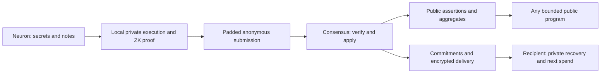

# privacy — a frozen anonymous machine

## 0. recommendation

Build the permanent monetary core from private programmable notes, hash-based
ownership and nullifiers, and a transparent zero-knowledge execution proof.
Publish anonymous assertions and the public state computed from them. Compute
with private witnesses at the neuron that possesses them. Require anonymous
submission and private recovery as part of the product. Keep the native
monetary law and its verification rules fixed at genesis.

This is the architecture selected by this research. Its production freeze is
blocked. The present harness is a useful implementation substrate; its current
cryptographic and network profiles do not establish the requested guarantee.
The research question is whether this particular composition can meet the
security and device budgets, with explicit leakage, before permanent genesis.

For the owner's satellite requirement, the launch verdict is: defer the
irreversible monetary genesis until the gates below close. The existing public
chain can exercise the harness under its existing contract. It cannot count as
the genesis of the permanently private, post-quantum currency described here.

This page proposes a decision. `draft` follows the proposals registry: owner
acceptance and implementation remain outstanding. Existing accepted specs,
release pins, monetary parameters and launch decisions are unchanged by this
research. Inspection evidence, exact revisions and executable counterexamples
are in [the research receipt](../audit/privacy-2026-10-16/README.md).



## 1. the promise to freeze

The primary interpretation is already explicit in [[cyber/launch]]: P1 makes
the [[cyberlink]] public and its author private. Everyone can learn the
assertions; the protocol conceals their assignment to private [[neurons]].
P2 conceals holdings and transfers. P3 conceals a settlement miner's private
witness beyond the authorized public result.

The guarantee is a simulation/indistinguishability claim: given the declared
public output and the adversary's own inputs, the observable execution should
reveal no additional protected information. Two honest authors exchanging
assignments to otherwise identical public assertions should be indistinguishable
under the declared network and corruption assumptions. Cryptographic hiding
and traffic-analysis resistance require separate arguments and compose at the
actual wire boundary.

| surface | public by construction | protected |
|---|---|---|
| monetary transition | accepted root, nullifiers, new commitments, fee class, padded envelope, proof | input-note association, ownership, amounts, asset/policy data unless explicitly disclosed |
| public assertion | particle pair and the application-approved public payload | author and its private authority/holdings |
| public [[focus]] computation | the declared aggregate graph and result | identities behind its contributions |
| private program | declared public IO and resource class | witness, private state and accesses inside that class |
| settlement | accepted input-domain commitment, epoch, authorized aggregates, payout commitments | protected contributor assignment, marginal vector and private ego-net |
| transport | declared schedule, packet class and service availability | assignment of originating connections to published assertions |

The application must explicitly choose whether an individual assertion weight
is public. Public per-assertion weights implement author privacy; hidden weights
with public sums require the aggregation protocol in §6. Public per-neuron
balance/focus/karma deltas are incompatible with claiming those same transitions
are unlinkable. Private reputation must travel as an authenticated private state
credential with controlled disclosure.

Authorized recipients and authors know their own interactions. A message can
identify its author by its content; unique values, timing and outside facts can
also identify it. The privacy game conditions on those intentional disclosures.
An unconditional promise that nobody can ever infer an author is unattainable.

## 2. what the workspace actually establishes

The research distinguishes default-branch code, release-branch code, local
research, measured fixtures and projections. Their exact snapshots are recorded
in [sources.json](../audit/privacy-2026-10-16/sources.json).

| claim | evidence and disposition |
|---|---|
| the current launch is already the permanent private core | refuted: [chain](../specs/chain.md) specifies public transfers/cyberlinks, NSIG1/secp256k1, and activation of privacy by later scheduled fork |
| private proving has made no progress | refuted: zheng's `origin/release/0.4` has masked proofs and a soundness ledger; the [latency receipt](../audit/proof-latency-2026-10.md), including its final fast-path follow-up, records substantial progress |
| those fixtures qualify private money and settlement | open: a hidden membership fixture is a component, while P2/P3 require complete accepted statements, recovery, network privacy and adversarial integration |
| the implementation called `veil` inherits the VEIL paper's guarantees | refuted as an identification: its own ledger describes a Libra-style masked sumcheck plus hiding PCS and explicitly distinguishes it from the VEIL paper |
| a classical ROM bound establishes the requested quantum guarantee | open: the current proof ledger prices grinding in the classical ROM; the deployed composition needs its own quantum analysis |
| current Hemera is ready for an irreversible security freeze | open: local research withdraws the degree argument for inverse partial rounds; the default branch still carries conflicting claims; output width also constrains the generic collision bound |
| a jali ciphertext norm verifies exact monetary conservation | refuted for the formula in `bbg/specs/privacy.md`; the receipt constructs a nonzero imbalance that passes its proposed check |
| resetting the live nullifier table preserves lifetime uniqueness | open unless an accepting proof authenticates all relevant spent history; an accumulator name and archived roots alone supply no such check |
| public aggregates always conceal individual contributions | refuted: subtraction, a singleton batch and colluding contributors reveal exact values |

The old [[privacy trilateral]] is useful as a list of tools. Its assertion that
every privacy application requires ZK, FHE and MPC together is too strong.
An owner can privately prove its own computation. Outsourcing computation on
unknown plaintexts and distributing a decryption authority are additional jobs.
Likewise, shared Goldilocks arithmetic alone establishes neither an FHE scheme
nor its security, error bounds or efficiency.

## 3. the monetary kernel

### 3.1 one private note model

Use one mandatory shielded note pool for the native currency. Voluntary
disclosure is an application proof/view of a note; it does not create a cheap
public transfer lane that empties the shared privacy pool.

The following is a relation sketch, with canonical tagged encodings throughout:

```text
note = (asset, bounded_integer_value, authority, policy, private_state, rho)
cm   = H_security("note", chain, encode(note))
nf   = PRF_nk("spent", chain, rho, cm)

state = (note_commitment_root, persistent_nullifier_root,
         public_graph_root, supply_state, protocol_context)
```

`rho` is fresh high-entropy note randomness. `nk` is derived from, and bound to,
the note's authorized private nullifier credential. Every valid spend of one
note produces the same nullifier, including threshold or delegated spends.
Changing the recipient policy consumes the old note and creates a new one.
The spender cannot choose an alternative `nk` or an epoch-dependent nullifier
to spend the old note again. Nullifiers are full security values, never one
Goldilocks element obtained by reduction.

Start with a conventional append-only hash tree of note commitments and an
exact persistent nullifier set. A public authenticated tree can contain hiding
commitments: its membership opening is checked inside ZK. A polynomial backend
can optimize that implementation only after its exact hiding, membership,
non-membership and update relations are qualified. Neptune's
[mutator-set work](https://eprint.iacr.org/2023/1208) is a useful alternative to
measure, with its witness-update and archival obligations included.

Pruning is allowed when authenticated evidence still permits every old valid
note to be spent and every old spent note to be rejected. Epoch boundaries
preserve this invariant. Tree capacity, historical-root acceptance, witness
updates and archive availability have to be specified before freeze.

### 3.2 the exact proof

The public statement binds the network/genesis, fixed proof profile, accepted
root, transaction intent, nullifiers, output commitments, delivery-data binding,
public effects, fee, validity window and padded resource class. The accepting
verifier derives the expected relation; a prover-supplied program digest cannot
replace the verifier's policy.

The private witness supplies input notes, membership paths, ownership material,
output preimages and application execution. The relation checks:

1. Every input belongs to an authenticated eligible root; all note encodings and
   values are canonical. Duplicate inputs/nullifiers within a transaction fail.
2. Its committed authority authorizes this exact intent. Recipient encryption
   keys and spending authority are independent: a sender knowing the delivery
   secret does not gain the recipient's spending credential.
3. Every nullifier is correctly derived from the consumed note. Consensus checks
   absence against current spent state and uniqueness across the admitted batch.
4. Per-asset integer conservation holds, with explicit mint/burn authority and
   native issuance restricted by the frozen law. Limb/range checks prevent field
   wraparound; equality modulo the Goldilocks prime is insufficient.
5. Each input policy accepts the transition and all successor state/policy
   obligations hold. The native currency's conservation/issuance predicate is
   enforced outside application discretion.
6. Public graph effects, encrypted delivery data and output commitments refer to
   the same transition. The recovery profile defines which delivery-consistency
   checks are proved, so an admitted payment has its promised recoverable data.

Validators apply those verified effects atomically to their own canonical
state. A historical-root membership proof does not establish present unspentness.
An outer aggregate verifies complete client proofs and their public effects;
the aggregator receives no spend secrets. Recursive compression is an
optimization with separate qualification. Direct verification remains the
reference semantics and sets an explicit finite block budget.

## 4. programmability and immutability fit together

A note carries a policy/program commitment and state. A bounded [[nox]] program
checks a spend and constructs successor outputs. [[trident]] supplies the
language; the frozen interpreter/relation supplies the meaning. Programs can
implement timelocks, escrow, swaps, delegated rights and application-specific
state transitions.

Three kinds of computation have different witness requirements:

| computation | chosen execution |
|---|---|
| custom program over published outputs | anyone executes it and can prove the result |
| custom program over a neuron's own hidden notes | that neuron executes/proves locally; verifiers learn the permitted result |
| custom program over hidden notes belonging to several independent neurons | explicit collaboration, MPC, or qualified encrypted evaluation; access policy and output disclosure are part of that application |

An opaque commitment supplies binding, not the ability to evaluate arbitrary
functions of its preimage. FHE enables ciphertext evaluation but still leaves
key ownership, release policy and distributed decryption to solve. General
FHE is therefore outside the mandatory monetary kernel.

Freeze the interpretation, encodings, native monetary law, admission relation,
proof verifier/parameters, accepted crypto profiles, resource bounds, conflict
rules and finality rules. New application programs remain ordinary data under
that fixed interpretation. They cannot replace the native verifier, expand
native mint authority or reinterpret old outputs. A new proof algorithm can be
implemented inside the old machine; its final acceptance still rests on the
old trust anchor. This supplies no rescue if that anchor breaks.

An immutable specification permits faster conforming implementations and
repairs of implementations that fail to implement it. It supplies no authority
to change the accepted state-transition relation. Universality does not make
the crypto foundation upgradeable, and governance cannot promise to prevent
people from creating a different fork.

The gold analogy is a commitment to fixed verification and issuance rules.
Scarcity/fungibility and economic value are separate properties. Cryptographic
security remains conditional on assumptions and a quantified adversary; no
finite deployed scheme establishes security for an unlimited future.

## 5. public collective knowledge and consensus

P1 publishes `(p, q, permitted_public_payload)` with a proof of anonymous
eligibility/resource expenditure. It omits the permanent neuron identifier,
identity signature, per-neuron nonce and private ownership opening. The fee
and stake resource come from shielded notes. Anonymous membership alone gives
no scarcity: Sybil resistance comes from the specified scarce resource and
replay/exclusivity rules.

Consensus can validate and order these proofs while reading the public graph.
The basic [[focus]] calculation then runs on public data. Neither a global
decryption key nor a private prover containing everybody's identity is needed.

If consensus itself requires private weighted votes, freeze a separate
credential relation: lock eligible stake through the voting/slashing interval;
authenticate its snapshot and weight; derive an exclusivity tag for the whole
conflict domain/round; bind the selected proposal in the proof. Putting the
proposal identifier in that exclusivity tag would allow one stake credential
to vote for every competitor. Vote switching, withdrawal and reorgs must have
one exact rule. Credential splitting cannot create additional weight.

This changes the author-based conflict check in `foculus/specs/protocol.md`.
The safety/liveness argument must be redone against the new observable data.
ZK proves validity; it supplies neither agreement nor availability. A public
validator role can coexist with anonymous assertions, but that role's actions
then have an explicitly public identity. Fully anonymous validators are a
further consensus requirement, not an implication of P1.

P3 is straightforward only when the miner already possesses every protected
input needed for its computation. Its proof publishes the authenticated input
scope, allowed result and payout commitments, while hiding the witness. Complete
scope is essential: proving a result over a hand-picked subset changes rewards.
If the function needs other neurons' unrevealed reports, §6 is mandatory.

## 6. the hard research boundary: secret collective inputs

[[valence]], BTS scoring, hidden weights and private contributor-grouped
settlement can need joint functions of inputs that no single prover knows.
Local proofs alone do not solve this. A central prover receiving all those
inputs violates the intended privacy boundary even if its final proof is ZK.

For this lane, select bounded epoch MPC with authenticated input commitments
and a publicly verifiable result as the research baseline. Use secure
aggregation for genuinely additive parts; use an explicitly malicious-secure
MPC relation for nonlinear scoring and witness-dependent settlement. Freeze
the accepted input set before computing; bind all shares/proofs to that set;
handle missing contributors, exclusions and exactly-once inclusion. Existing
[secure aggregation](https://eprint.iacr.org/2017/281) establishes feasibility
for sums under its own model, not a PQ implementation of our reward function.

The protocol must specify the corruption threshold, participant selection,
authenticated PQ channels, share consistency, distributed proof production,
timeout/abort rules and recovery. A public proof of shares being processed
correctly does not prove that the shares encode eligible complete inputs.
Hashing Shamir coefficients does not by itself implement verifiable sharing.

Confidentiality depends on the stated non-collusion bound and, for proactive
security, timely refresh and actual erasure. Offline contributors need durable
shares/ciphertexts and a defined availability service. A long-lived threshold
FHE key would transfer the same problem to a decryption committee and expose
archived ciphertexts if enough shares later leak. Permissionless admission
alone establishes no honest threshold.

Output leakage remains even with perfect MPC. If `S = sum(x_i)`, an adversary
knowing every term except one recovers that last term. Publishing two exact
sums over sets differing by one contributor has the same effect. Arbitrary
public programs returning `x_i` cannot coexist with concealment of `x_i`.
Fix the release function and cadence, analyze adaptive overlapping releases
and sparse contributions, and state the residual leakage. Batch size alone
does not count independent honest participants. Differential privacy belongs
to suitable analytics; monetary conservation and deterministic finality retain
exact arithmetic.

Decision: qualify this lane before activating any native reward/consensus rule
that requires its protected inputs. If those rules define the intended native
currency at genesis, the whole permanent genesis waits for this lane. Calling
it an optional later privacy upgrade would change the owner's requirement.

## 7. transport, delivery and recovery

### anonymous ingress

Use a dedicated mix layer with fixed packet classes, independent delay/batching,
cover traffic, replay defenses and an authenticated relay directory. Charge its
resource use through unlinkable authorization, and include its cost in fees.
The adversary model includes observation of ingress and public publication,
malicious relays, active dropping/tagging, intersection attacks, retries and
low-traffic periods. Honest relay assumptions must specify path selection,
corruption timing, erasure and how anonymity survives an active adversary.

[[radio]] supplies transport, not this end-to-end anonymity guarantee. QUIC
encryption, a fresh transport key, or a single forwarding relay is insufficient.
Packets containing one large proof must be padded and scheduled as a bundle;
packet-count patterns can identify a transaction even when individual packets
are fixed-size. Cover traffic must reach the observable layer being protected.

The [anonymity trilemma](https://eprint.iacr.org/2017/954) makes this a real
latency/bandwidth tradeoff under its global-observer model.
[Loopix](https://www.usenix.org/conference/usenixsecurity17/technical-sessions/presentation/piotrowska)
is an architectural reference for traffic shaping; its original cryptography
is not a ready PQ packet profile. PQ packet composition and active security
are freeze gates. A direct, identity-bearing fallback must surface an explicit
weaker guarantee rather than silently satisfy a private submission request.

### recipient delivery

Select standard ML-KEM-1024 plus a reviewed KEM–KDF–AEAD composition as the
qualification baseline for `mudra::seal`. Preserve the
[FIPS 203](https://csrc.nist.gov/pubs/fips/203/final) algorithms and parameters;
rewriting its ring into Goldilocks creates a new cryptosystem. CSIDH and a
custom native-field KEM remain outside the permanent baseline.

Recipient-key privacy and ciphertext robustness need separate review. An
IND-CCA KEM certificate is not a recipient-anonymity certificate; the
[anonymous PQ encryption literature](https://eprint.iacr.org/2021/708) explains
the distinction. This paper predates final ML-KEM and is not evidence of an
attack on today's standard. Until the exact delivery envelope's anonymity
argument closes, private recipient delivery remains blocked. Key directories,
view tags, address reuse and access logs belong in that argument.

Freeze a padded, durable encrypted notification board with each ciphertext
bound to its output. Separate spend, view/discovery and transport keys.
The sender must never learn the recipient's spend secret. A compromised view
key exposes its advertised history; a long-lived recovery key is incompatible
with claiming erased historical access under that same key.

### recovery is part of ownership

Follow [[mudra/private recovery]] and [[cybergraph/private retrieval]]: a spell
reconstructs keys, while archives preserve notes and membership/spent evidence.
Use a complete local scan as the reference recovery algorithm, with fixed
traffic behavior where required. Private indexed retrieval and prepared
encrypted checkpoints are optimizations with completeness proofs.

Measure discovery, restoration and spend preparation separately. Private
membership paths fetched by ordinary address-specific RPC disclose which
note is being spent. Use local data or a qualified private retrieval profile.
Lost archives, provider refusal, overflow, cold restore, key epochs and reorgs
must have executable recovery behavior. A succinct proof cannot reconstruct
missing ciphertexts.

## 8. the quantum and lifetime freeze

Set a minimum target of 128-bit post-quantum work resistance for the monetary
security profile, with a separately budgeted lifetime soundness/hiding error.
This is a proposed requirement consistent with [[proof-system-repair]], not a
claim about present code. Fix the attack model and exposure budget first.

The concrete conservative reference is SHA3-512 for security commitments,
program/policy binding and authenticated state, and standardized SHAKE256-based
derivation with explicit domains where required. [FIPS 202](https://csrc.nist.gov/pubs/fips/202/final)
defines those primitives. The proof's own binding/transcript construction must
meet the same target, including internal Merkle nodes; an outer strong hash
cannot repair a weak inner proof or an already-collided state root.

Keep the existing 32-byte Hemera [[particle]] as a file locator only where its
security model permits. Add a distinct, full-width security commitment for
consensus-critical payloads/programs; validators authenticate the actual bytes
against it. A 32-byte particle alone cannot name executable policy authoritatively
under a stronger collision target. This is an explicit pre-genesis type/schema
change. If every security binding must remain the present Hemera value, the
stronger freeze requirement fails.

For an ideal n-bit output, the generic quantum collision algorithm has roughly
`2^(n/3)` query cost; this is a model bound with substantial resource assumptions,
not an announcement of a practical attack. A 256-bit output consequently
cannot support a blanket 128-bit quantum collision claim. Wider output alone
does not strengthen an internally narrower construction: expanding BLAKE3's
output or hashing a short digest again does not repair its binding. See
[Brassard–Høyer–Tapp](https://arxiv.org/abs/quant-ph/9705002).

The field-native proof hash is an optimization research question, with the
conservative construction as the comparison. Reusing an independently reviewed
exact parameter set is preferable to inventing an inverse-S-box security
argument. Any promoted replacement has to close its own complete security
ledger and measured advantage before the single production profile is frozen.
This page does not certify SHA3-based proving as fast enough on this harness.

The proof audit must cover the exact relation, hiding of every transcript
message, fresh entropy, Fiat–Shamir in the quantum random-oracle model,
grinding, multi-target/lifetime losses, nested verification and side channels.
Goldilocks execution can remain, with an adequately sized extension challenge
field and canonical sampling. A base-field bit count and a hash bit count are
not interchangeable.

The current release ledger's masking-error upper bound is also material:
it has a term proportional to `types * log(m) / p`, despite extension-field
challenges. That upper bound does not demonstrate an attack, but it does not
establish the requested lifetime hiding budget either. Improve the construction
or tighten the argument; a distribution test is no replacement for either.

Freeze forbids an automatic public-proof fallback, indefinite secp256k1 native
authorization, a privileged mint/recovery master key and verifier replacement
by an activation vote. Legacy ownership must be re-authorized into the final
PQ profile under an explicit pre-genesis distribution process. Unclaimed legacy
balances force a real decision: retaining a classical claim path retains its
classical security. No proof wrapper makes an exposed legacy key quantum-safe.

## 9. efficiency on the actual harness

Optimize after fixing the relation and leakage: specialized digest-pair gadgets,
shared membership paths, reusable proving keys, fixed common transaction shapes,
batch verification and off-device aggregation of already private proofs. Keep
raw witnesses on the originating device or explicitly inside its trust boundary.
Held proving keys may be reused; hiding coins may not.

Use the current [[zheng]]/[[lens]] release work as a baseline, including the
final follow-up of the [latency report](../audit/proof-latency-2026-10.md).
Its private node-membership optimization is real recorded progress. It still
does not meet all proof-size goals and does not measure this complete payment,
delivery or consensus relation. Historical timings cannot be transferred to a
different hash, tree, statement or quantum parameter set.

The experiment compares complete P1, P2 and P3 fixtures at identical security:
CPU, Metal and available mobile hardware; cold/warm prover latency and peak
memory; first/repeated verification; proof, ciphertext and cover-traffic bytes;
witness maintenance; full/warm recovery; archive growth; and adversarial rejection
cost. Report medians and tails with committed revisions, hardware, parameters
and commands. Device budgets include delivery construction and private reads.

Carry the existing warm device proving target of at most one second; the
small/large proof and verification targets of [[proof-system-repair]] stay
targets. Add explicit total transaction and network-delay budgets before the
experiment. Security parameters cannot be reduced to make a latency row green.
If the required security and efficiency fail together, the final genesis waits.

## 10. research programme and closing conditions

No new fundamental primitive is needed for private notes, owner-proved
programs and anonymous public assertions. There is substantial engineering and
cryptographic qualification work. The full hidden-input reward/consensus
machine, compact PQ hiding proofs and their composition on this harness are
research-grade. The work is bounded by questions with falsifiable outcomes.

| question | owner | closing evidence | blocks |
|---|---|---|---|
| G1: what exactly may an observer learn across P1/P2/P3 and valence? | soft3, mudra, foculus | accepted leakage/adversary model; author-swap game; sparse/overlap/collusion analysis | permanent genesis |
| G2: can the exact hash/proof composition meet the quantum and lifetime budgets? | hemera, lens, zheng | reviewed exact parameters, QROM/grinding/composition argument, hiding bound, independent verifier and adversarial fixtures | permanent genesis |
| G3: does one complete private spend conserve value and remain spendable forever? | bbg, tok, mudra, zheng | malicious-prover tests for inflation, wraparound, forged authority, same/batch/cross-epoch double spends; archive and root-update recovery | permanent genesis |
| G4: can contracts preserve private state under bounded execution? | nox, trident, joy | reference evaluation agrees with proof relation for authorization, calls, private reads, branches and successor policies; compiler semantics checked separately | programmable genesis |
| G5: can secret collective inputs be settled without a privileged reader? | foculus, mudra, zheng, tru | a specified malicious-secure MPC protocol, threshold/availability model, complete-input proof and dropout/reorg/payout fixtures | native hidden-input settlement and any genesis requiring it |
| G6: can a global observer link ingress or recovery to the published action? | radio, cybergraph, cyb, mudra | reviewed PQ mix/delivery composition; active attacks and realistic low-load/intersection experiments; key-private recovery | claimed end-to-end privacy |
| G7: does the complete composition fit the product budgets? | joy, honeycrisp, soft3 | reproducible end-to-end cold/warm receipts under the accepted G1/G2 profile; sustained-load and hostile-input runs | permanent genesis |

Run G1 first. Build the conventional hash-tree/private-note reference and
conservative crypto baseline next. Close the proof/delivery security questions
while measuring that complete relation. Develop the secret collective-input
lane against the real valence/settlement function, not an unrelated private sum.
Only after these converge should owner repositories receive final normative
specs, wire changes and executable release gates.

The strongest technical research investment is a compact, quantum-analyzed
hiding proof for the actual nox relations, followed by a minimal-disclosure
settlement protocol. Inventing a new KEM, a new commitment norm test or a new
general FHE scheme is outside the selected baseline.

Acceptance requires review of the exact deployed revisions and origin-pushed
inputs, not an architecture diagram or a successful honest proof. Publish the
red results as well as the green ones. The eventual freeze receipt fixes one
profile and one set of semantics; unresolved security rows keep it open.

## 11. alternatives and the decision they lose

| alternative | disposition |
|---|---|
| publish now, hide old history later | historical disclosure is irreversible; useful rehearsal, different permanent promise |
| FHE for every transfer and program | adds ciphertext/proving/key-management cost to work the owner can already perform privately; reserve it for applications that need encrypted evaluation |
| one global threshold decryption key | makes confidentiality depend on cumulative committee compromise; outside the monetary kernel |
| classical curve commitments or recursive curve wrappers | retain a discrete-log security dependency; outside the PQ baseline |
| CSIDH plus an unqualified native-field KEM | increases new cryptography on the irreversible path; use the standard delivery baseline and qualify anonymity explicitly |
| aggregate everything into one proof | reduces verification overhead after qualification; does not erase network observations, public IO or the aggregator's learned witnesses |
| keep every current byte and still claim the stronger security target | incompatible with the observed weak/narrow bindings and public signature profile |

The proposed decision is concrete: private programmable notes and anonymous
public assertions form the core; mandatory anonymous transport and recoverable
delivery complete the product; bounded MPC handles genuinely joint secrets;
the monetary law stays fixed. Freeze follows the evidence for that whole
composition. The present research verdict on that freeze is no-go.

## sources for the external constructions

These are construction references, not certification of our implementation:

- [Zerocash](https://eprint.iacr.org/2014/349): private note/membership/nullifier
  architecture; its original proof assumptions are not the selected PQ profile.
- [Neptune transaction semantics](https://docs.neptune.cash/consensus/transaction.html):
  programmable lock/type checks, conservation and proof composition.
- [WHIR](https://eprint.iacr.org/2024/1586), [Arc](https://eprint.iacr.org/2024/1731),
  [VEIL](https://eprint.iacr.org/2026/683): opening, accumulation and hiding research;
  each integrated profile still owes its own compositional security argument.
- [Secure aggregation](https://eprint.iacr.org/2017/281),
  [database privacy](https://www.microsoft.com/en-us/research/project/database-privacy/):
  private computation and the independent problem of information released by outputs.

All external sources were opened on 2026-10-16. Local evidence takes precedence
for claims about what this stack has actually implemented.
